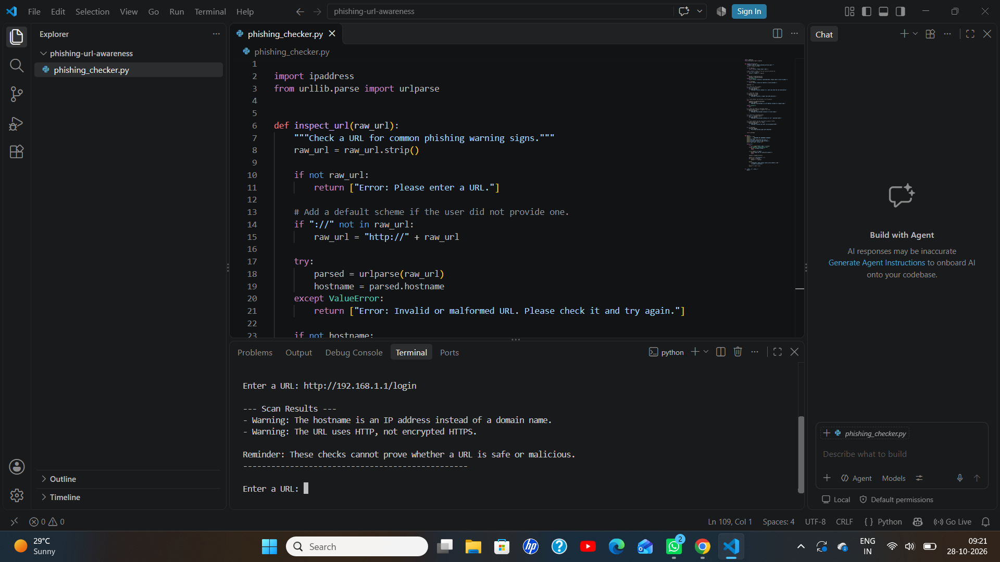
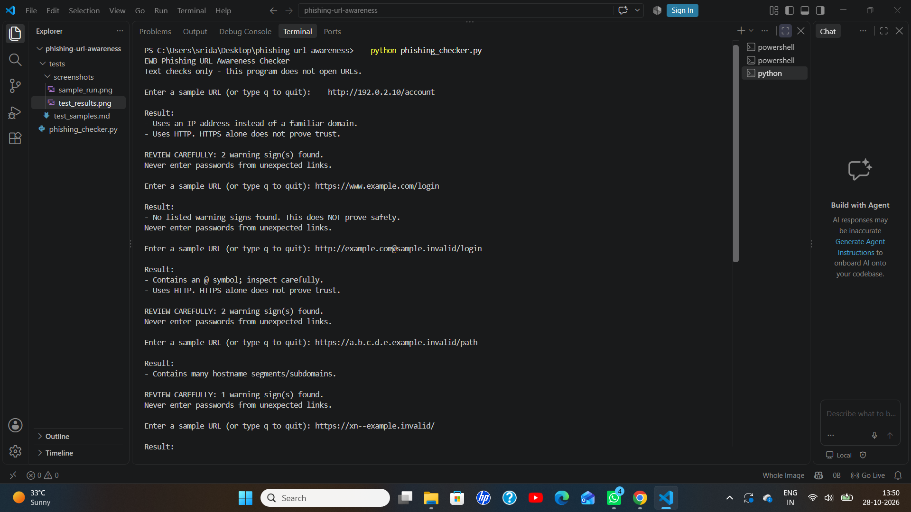

# EWB Phishing URL Awareness Checker

## Overview
Phishing is a trick where a fake link is used to steal passwords or payment details. This tool reads the text of a URL and points out simple warning signs. It never opens the link.

## Features
- Detects an @ symbol in the URL
- Flags unusually long URLs (over 100 characters)
- Flags IP-address hostnames
- Flags many hostname segments (5 or more)
- Flags punycode-style hostnames (xn--)
- Flags the HTTP scheme
- Loop: checks several URLs without restarting, and quits with q
- Review summary: prints a REVIEW CAREFULLY message with the number of warnings
- Safe input handling: does not crash on badly formed input like http://[bad

## Requirements
Python 3.10 or later. No extra packages.

## How to Run
Windows: python phishing_checker.py
Mac/Linux: python3 phishing_checker.py

## Example Output
```
EWB Phishing URL Awareness Checker
Text checks only - this program does not open URLs.

Enter a sample URL (or type q to quit): http://192.0.2.10/account

Result:
- Uses an IP address instead of a familiar domain.
- Uses HTTP. HTTPS alone does not prove trust.

REVIEW CAREFULLY: 2 warning sign(s) found.
Never enter passwords from unexpected links.
```

## Testing
| # | Input | Expected | Actual | Result |
|---|-------|----------|--------|--------|
| 1 | https://www.example.com/login | No warning signs | No listed warning signs found | PASS |
| 2 | http://192.0.2.10/account | IP address + HTTP | IP address + HTTP warnings | PASS |
| 3 | http://example.com@sample.invalid/login | @ symbol + HTTP | @ symbol + HTTP warnings | PASS |
| 4 | https://a.b.c.d.e.example.invalid/path | Many hostname segments | Many hostname segments warning | PASS |
| 5 | https://xn--example.invalid/ | Punycode-style hostname | Punycode-style warning | PASS |

The full table is in tests/test_samples.md.

## Screenshots



## Improvements
1. Loop with quit - I added a while loop so I can check many URLs without restarting the program. Typing q ends it. I tested it by entering several URLs and then q.
2. Review carefully summary - I added a message that shows how many warning signs were found, so the result is easy to understand. I tested it with http://192.0.2.10/account and it showed 2 warnings.
3. Malformed input handling - I added try/except so the program does not crash on bad input. I tested it with http://[bad and it showed a clear message instead of an error.

## Limitations
This is an educational tool. It only reads URL text. It does not visit
URLs, scan for malware or prove that a URL is safe. No warning signs
found does NOT mean a URL is safe.

## Ethical Use
Use sample strings only. Do not collect credentials. Do not use this
project to deceive anyone or to test websites without permission.

## Author
S.B.Sridarshini,AI Powered CyberSecurity, EWB Courses